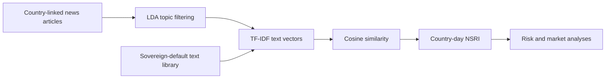

# Can Financial News Predict Sovereign Default Risk?

**A research case study on NLP, sovereign credit risk and financial-market spillovers**

> **Project type:** Collaborative university research presentation, adapted into a recruiter-facing case study. **Course:** Data Analytics & Machine Learning in Finance. **Research reviewed:** *Hot off the Press: News-implied Sovereign Default Risk*, by C. Dim, K. Koerner, M. Wolski and S. Zwart (2021; revised April 2024, as identified in the class slides).

## The question

Can news text identify rising sovereign credit risk before conventional indicators—such as credit ratings, infrequently updated macroeconomic statistics, or sovereign CDS prices—fully reflect it?

This case study explains the **News-implied Sovereign Risk Index (NSRI)** described by the paper's authors, summarizes the empirical findings presented by our group, and evaluates their practical relevance and limitations.

**Important distinction:** The NSRI methodology and empirical findings belong to the paper's authors. This project is a **collaborative academic review and presentation**, not an original NLP implementation, new dataset, independent replication, or personally authored paper.

## At a glance

| Research component | What the group examined |
| --- | --- |
| Motivation | Ratings and macroeconomic indicators can lag; sovereign CDS markets can be illiquid |
| News dataset | About 10 million English-language articles, 2,100 publishers and 184 countries, as described in the slides |
| NLP methodology | LDA topic filtering, TF–IDF text representation, cosine similarity to a sovereign-risk text library |
| Validation | News content checks and time-series comparison with known risk episodes |
| Empirical applications | CDS spread changes, rating downgrades, domestic firm credit risk, equity returns, market timing |
| Robustness | Alternative specifications, horizons and leave-one-country-out checks |

## How the news-based risk index works

*Conceptual reconstruction of the methodology described in the paper and group presentation; not executable model code.*

For the fuller explanation, see [NLP methodology](methodology.md).

## What the paper reports

| Outcome | Finding summarized by the group | Interpretation |
| --- | --- | --- |
| Sovereign CDS | Current NSRI predicts increases in CDS spreads over 1-, 3- and 6-month horizons | News may contain risk information not yet fully reflected in prices |
| Rating downgrades | Higher NSRI is associated with a higher probability of downgrades over the next 3–12 months | A potential early-warning indicator |
| Domestic firms | NSRI predicts future firm-level aggregate credit risk after reported controls | Sovereign concerns can spill over to corporate borrowing conditions |
| Equity markets | A one-standard-deviation NSRI change is associated with lower subsequent country equity returns | Sovereign risk news may matter for valuation |
| Market timing | The paper illustrates stronger historical performance for an NSRI-based switching strategy | Economic relevance, **not** a verified live investment strategy |

These are **reported associations and backtest results**, not causal estimates established by this repository. See [Empirical findings](empirical-findings.md) for figures, study design and robustness.

## Critical assessment

The study is attractive because text is available more frequently than many conventional sovereign-risk indicators, including in less liquid markets. Practical deployment nevertheless depends on news coverage, language selection, changing text distributions, timestamp integrity, and transaction costs. Predictive correlations do not automatically establish causal effects.

See [Critical evaluation](critical-evaluation.md).

## Explore the case study

- [Methodology — constructing the NSRI](methodology.md)
- [Empirical findings — CDS, downgrades, firms, equities and timing](empirical-findings.md)
- [Critical evaluation and practical implications](critical-evaluation.md)
- [Research sources and group attribution](references.md)

## Attribution and publication choices

This case study was adapted from a **seven-person group presentation**. The original presentation lists Lucas Burlon, Robin Förster, Louis Häffner, Maximilian Heinl, Emanuele Licata, Ishita Pandey and Richard Stern. The available materials do not identify individual slide responsibilities; no exclusive ownership or specific division of labor is claimed.

The original slide deck is **not uploaded**. It contains group names and classroom-only quiz placeholders; the case study instead provides an original written synthesis and a newly authored text diagram. The underlying research paper is also not redistributed. No open-source license is granted.

*Educational research communication; not investment advice.*
