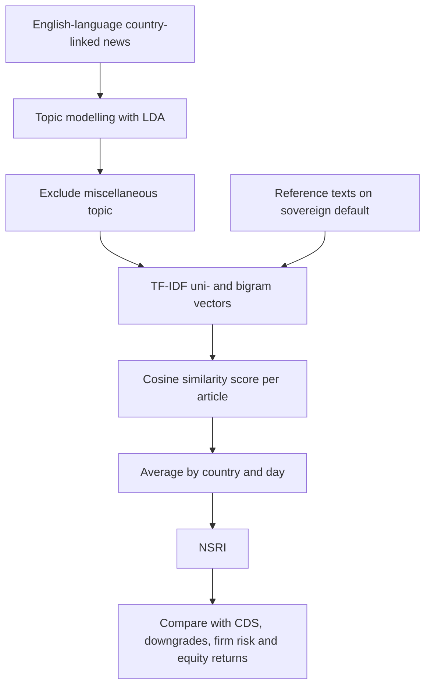

# Methodology: From news articles to a sovereign-risk signal

*This document explains the published paper's framework as summarized in the group's presentation. It does not describe code or an NLP model built by the student group.*

## 1. Why measure sovereign risk from news?

Conventional risk monitoring relies on macroeconomic statistics and credit ratings, which may be published infrequently or updated after important events. Sovereign credit default swaps (CDS) can provide market-based risk measures, but liquid CDS prices are unavailable for some countries. News can respond quickly to political, social, economic and financial developments.

The paper proposes the **News-implied Sovereign Risk Index (NSRI)** as a text-based complementary measure—not a replacement for ratings or market prices.

## 2. Data coverage

The group's slide 8 describes roughly **10 million English-language news articles**, **2,100 publishers** and **184 countries**. Articles include news published locally or in the United States, United Kingdom and China. Other sources discussed in the presentation include sovereign CDS spreads, equity indices, credit-rating changes and macroeconomic variables.

These counts and data descriptions come from the presentation; the raw news corpus is not part of this repository.

## 3. Topic filtering with LDA

A broad news scrape includes irrelevant material. The paper uses **Latent Dirichlet Allocation (LDA)** to discover nine latent topics, assigns each article to its highest-probability topic and removes a miscellaneous category. The slides name economy, business, two governance topics, security, environmental, health, tourism and miscellaneous.

**Purpose:** reduce noise by focusing on news categories likely to contain sovereign-risk information.

## 4. Text representations

The relevant news articles and a separate **sovereign-default risk language library** are represented using unigram and bigram **bag-of-words** features with **term frequency–inverse document frequency (TF–IDF)** weighting. The library described in slide 10 includes rating-downgrade documents, institutional reports and default case studies.

TF–IDF reduces the weight of common vocabulary relative to more distinctive terms.

## 5. Cosine similarity and aggregation

The core measure compares a news article's vector with the risk-library vector using cosine similarity:

\[
\operatorname{cosine}(u,v)=\frac{u\cdot v}{\lVert u\rVert\lVert v\rVert}.
\]

Higher similarity means that the article's language is closer to the reference language associated with sovereign default concerns. The article scores are averaged at the **country × day** level to construct the NSRI. The presentation also discusses a tone-adjusted version (**tNSRI**) using negative textual tone.

This is a conceptual description, not a claim that similarity directly estimates a probability of default.

## 6. Conceptual and empirical validation

The slides describe checking influential terms in the default-risk library, scoring held-out article categories (default, socioeconomic crisis and unrelated news), and examining global time-series dynamics. They also compare tone-adjusted and baseline measures.

## 7. Workflow

**Source within the group presentation:** slides 5–12. See [references and attribution](references.md).
